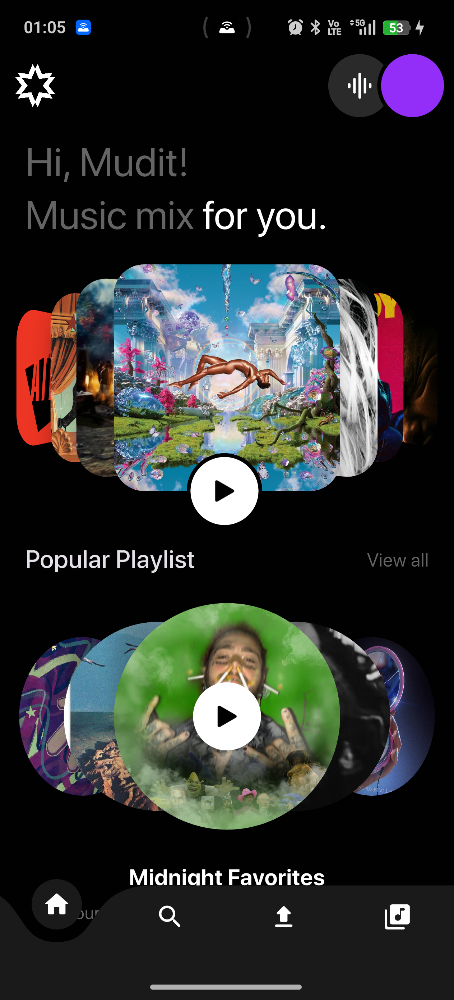
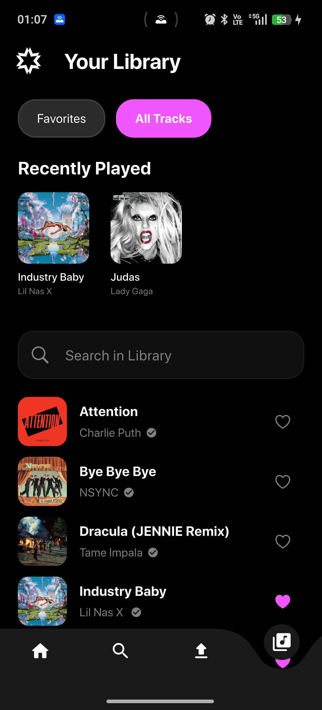
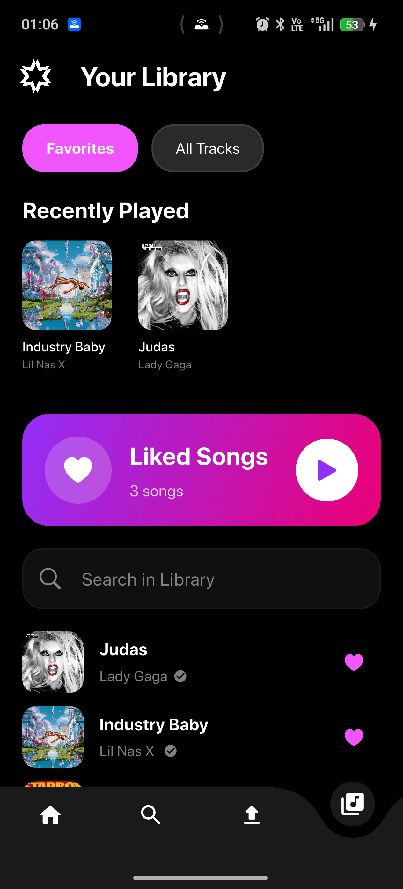

# Vibe

[](https://github.com/mudit-palvadi/Vibe/actions/workflows/ci.yml)

Vibe is a cross platform music app built with Flutter. The users sign in with their Google account, listen to the songs of a shared catalog, search it, keep their favourites, and upload their own songs.

The app talks to the [Vibe backend](https://github.com/mudit-palvadi/Vibe-Backend), a FastAPI service that runs on AWS as a Lambda behind CloudFront. The audio files and the covers live in an S3 bucket, the app uploads to the bucket itself and never sends the files through the backend.

---

## Screens

| Home | All tracks | Favourites |
| :---: | :---: | :---: |
|  |  |  |

---

## Features

- **Google sign in.** The app opens the system browser, the Google id token is checked by the backend, and the app gets a session token that lasts 30 days.
- **A session that survives a restart.** The session token is kept in a hive box on the device. When the app is opened again it asks the backend whether the token is still good, and only signs in again when it is not.
- **Background playback.** JustAudio with a background service keeps the music playing when the app is not in front.
- **Waveform scrubber.** The player draws the waveform of the song and lets you move through it.
- **Search.** The search looks at the title, the artist, and the tags of the songs while you type.
- **Favourites.** The heart on a song adds it to the favourites of the user or takes it away again, and the library keeps a list of them.
- **Recently played.** The songs that were played are kept on the device in a hive box.
- **Uploads.** The user picks an audio file and a cover, fills in the title, the artist, and the tags, and the app sends the files straight to the bucket with the links the backend gives it.
- **A shared catalog.** Every song is visible to everyone, an upload joins the catalog for the whole app.

---

## Tech stack

| Piece | What it is used for |
| :--- | :--- |
| **Flutter & Dart** | The app itself, it runs on Android, iOS, web, Windows, Linux, and macOS. |
| **Riverpod** | The state. The providers are written with annotations and the code is made by the generator. |
| **google_sign_in_all_platforms** | The Google sign in. It uses the system browser on the desktop and the credential manager on the phone. |
| **JustAudio & JustAudioBackground** | The playback and the background service. |
| **audio_waveforms** | Draws the waveform of the song in the player. |
| **Hive** | The small things that stay on the device: the session token, the Google refresh token, and the recently played songs. |
| **http** | The calls to the backend and the uploads to the bucket. |
| **crypto** | The sha256 hash of the body of a request, the CloudFront signature needs it. |
| **file_picker** | The audio file and the cover of an upload. |
| **fpdart** | The results of the calls, an `Either` instead of exceptions. |
| **flutter_dotenv** | The settings of the app come from the `.env` file. |

---

## The layout

The app is split in two parts. Everything that is shared lives in `core`, everything that belongs to one screen lives in its own folder under `feature`.

```text
lib/
├── core/
│   ├── constants.dart               # the settings of the app and the header names
│   ├── failure/failure.dart         # the failures the repositories can return
│   ├── models/user_model.dart       # the user and their favourites
│   ├── providers/                   # the state that is used everywhere
│   │   ├── current_song_notifier.dart
│   │   ├── current_user_notifier.dart
│   │   └── recently_played_provider.dart
│   ├── services/                    # the talks to the outside world
│   │   ├── api_service.dart         # the calls to the backend
│   │   ├── body_hash.dart           # the sha256 hash of the body of a request
│   │   ├── google_auth_service.dart # the google sign in
│   │   ├── recently_played_service.dart
│   │   └── session_storage.dart     # the session token on the device
│   ├── theme/                       # the colours and the theme
│   ├── widgets/                     # the widgets that are used everywhere
│   ├── fonts/ icons/ images/        # the assets of the app
├── feature/
│   ├── auth/                        # the sign in and the wrapper that watches it
│   ├── home/                        # the home page with the carousels
│   ├── library/                     # the favourites and all the tracks
│   ├── music/                       # the player, the upload page, the models of a song
│   └── search/                      # the search page
├── main.dart                        # starts the app, the storage, and the audio service
test/                                # the tests of the services and of the repositories
```

---

## Getting started

### Prerequisites

- The [Flutter SDK](https://docs.flutter.dev/get-started/install) (3.44 or newer)
- A running backend, the [Vibe-Backend](https://github.com/mudit-palvadi/Vibe-Backend) repository

### 1. Get the code

```bash
git clone https://github.com/mudit-palvadi/Vibe.git
cd Vibe
```

### 2. The packages

```bash
flutter pub get
```

### 3. The settings

Copy `.env.example` to `.env` in the root of the project and fill in the values:

```ini
# the address of the backend
BACKEND_URL=https://d3hb9a4bci0gq5.cloudfront.net

# the google oauth client of the app, a web type client with the address
# http://localhost:<GOOGLE_REDIRECT_PORT> as a redirect uri
GOOGLE_CLIENT_ID=
GOOGLE_CLIENT_SECRET=
GOOGLE_REDIRECT_PORT=8000
```

`GOOGLE_CLIENT_ID` and `GOOGLE_CLIENT_SECRET` belong to the same Google client that the backend uses, the backend checks the audience of the id token against it.

### 4. The generated code

The Riverpod providers are written with annotations, the code of the providers is made by the generator:

```bash
dart run build_runner build --delete-conflicting-outputs
```

### 5. Run it

```bash
flutter run              # on a connected device
flutter run -d windows   # on the desktop
```

---

## The Google client

The app needs a Google OAuth client. The one type that works on every platform is a **Web application** client, because the Flutter package opens the system browser and comes back to a local address:

1. In the [Google Cloud console](https://console.cloud.google.com/) open **APIs & Services** → **Credentials** and make an **OAuth client ID** of the type **Web application**.
2. Add `http://localhost:8000` as an **Authorized redirect URI**. The port is the `GOOGLE_REDIRECT_PORT` of the `.env`, the package listens on it and gets the code back there.
3. Put the client id and the client secret in the `.env` of the app.

The desktop apps that are not published anywhere need nothing more than that, the secret of a web client is not a real secret and the app is a public client.

### On a phone

An Android app also needs its own **Android** OAuth client, because the credential manager checks the package name and the signing key of the app:

- the **package name** is `com.example.vibe`, it is in `android/app/build.gradle.kts`
- the **SHA-1** of the signing key. For a debug build it is the one of `~/.android/debug.keystore`, the password of that keystore is `android`:

  ```bash
  keytool -list -v -keystore ~/.android/debug.keystore -alias androiddebugkey -storepass android
  ```

The Android client is only there to say that this app, signed with this key, may sign in. The id token that comes back is still the one of the web client, and the backend checks that one.

---

## How the app talks to the backend

Every call to the backend carries the session token in the **`x-vibe-auth`** header. CloudFront signs the request it sends to the Lambda and takes the `Authorization` header of the caller away, so the token needs its own header.

A request with a body also needs the **`x-amz-content-sha256`** header with the sha256 hash of the body. The CloudFront signature needs it to check the body it forwards. The `bodyHeaders` helper in `lib/core/services/body_hash.dart` makes that header, it is used by every call that has a body.

```text
POST /auth/login          the google id token in          → a session token that lasts 30 days
POST /auth/refresh        the google refresh token in     → a new session token
GET  /auth                the session token in the header → the user and their favourites
GET  /song/list           → every song of the catalog
GET  /song/search?q=      → the songs that start with the word
POST /song/favourite       → adds the song to the favourites or takes it away
GET  /song/list-favourites → the favourite songs of the user
POST /song/upload-init    → the links for the upload
POST /song/upload-complete → the song is saved
```

### The upload

The files do not go through the backend, the 6 MB limit of a Lambda would not allow it:

1. The app asks `POST /song/upload-init` with the title, the artist, the tags, and the file names.
2. The app puts the audio file and the cover on the two links it gets back, those go straight to the bucket.
3. The app asks `POST /song/upload-complete` with the song id, the details, and the two keys. The backend moves the files to their place and saves the song.

---

## The tests

```bash
flutter test
```

The tests cover the api service, the session handling of the auth repository, and the hash of the body. They do not need a backend, the calls are made to a mock.

---

## The backend

The backend of the app is in [mudit-palvadi/Vibe-Backend](https://github.com/mudit-palvadi/Vibe-Backend). Its readme has the details of the api, of the database, and of the deployment.
